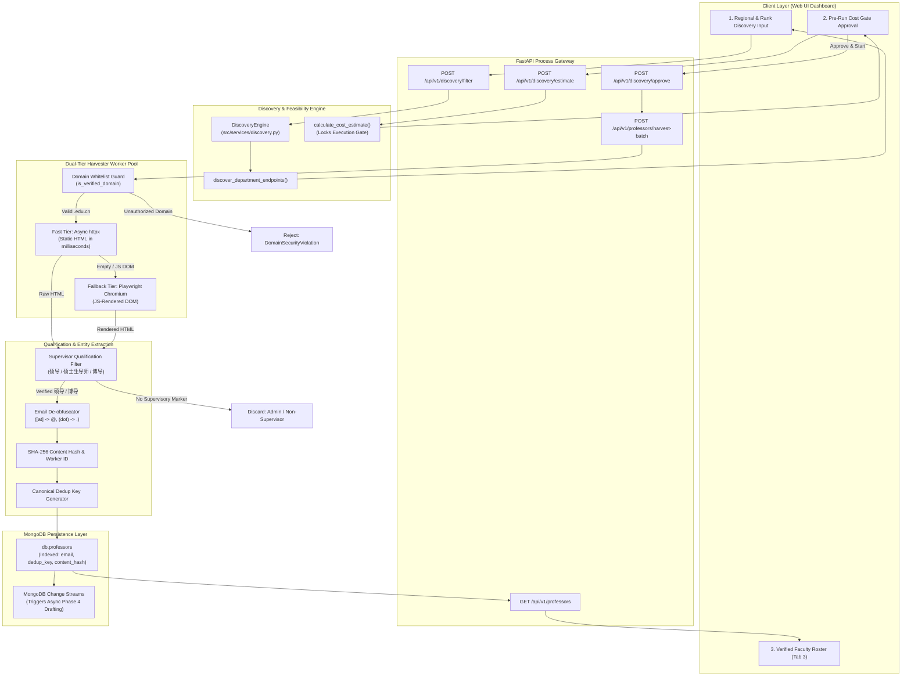
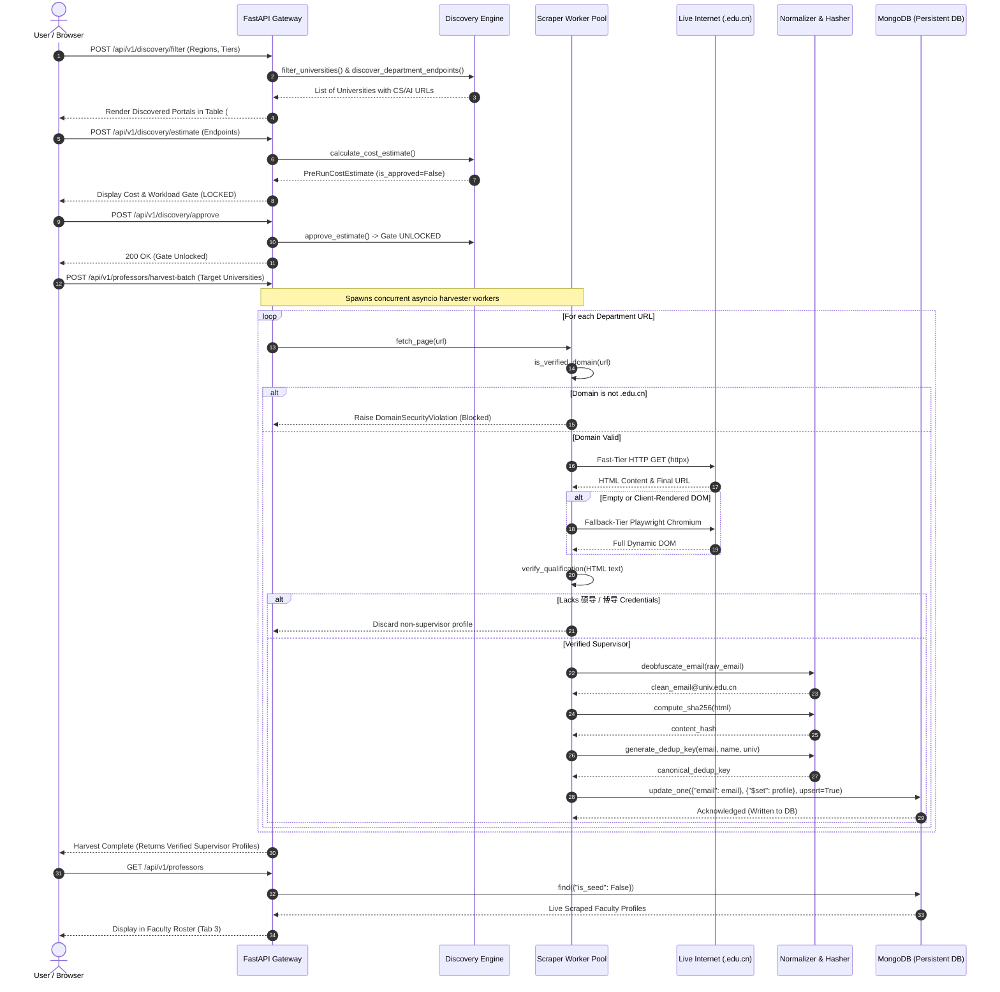
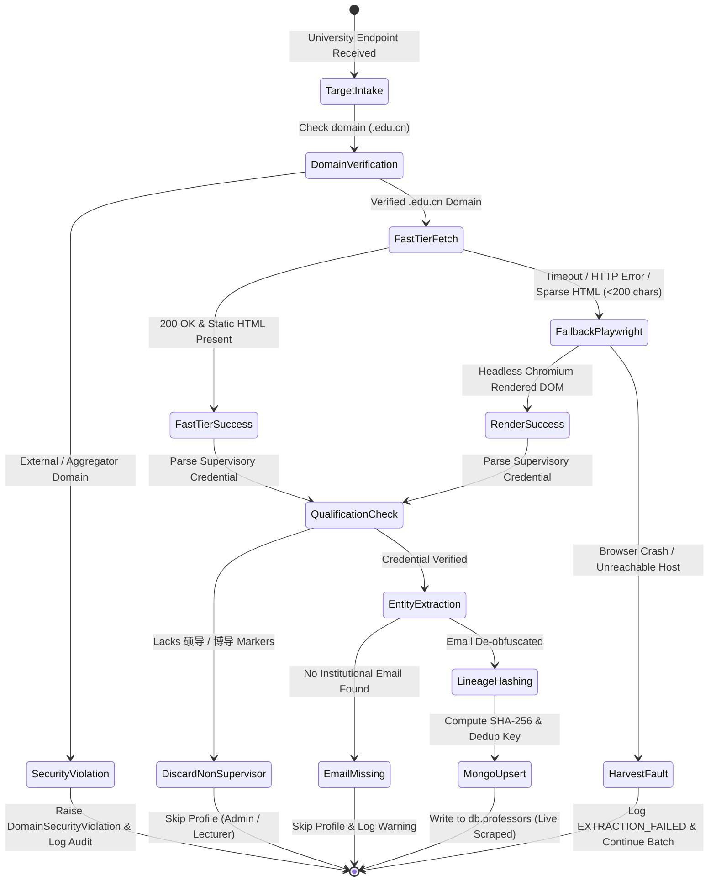

# AutoAdmit Engine: Phase 1 Data Extraction & Discovery Architecture

> **Document Version:** 1.0.0  
> **Target System:** AutoAdmit Engine  
> **Governance References:** [`PRD.md`](./PRD.md) (Modules 2, 3, 4) & [`rules.md`](./rules.md) (Rules 1, 2, 3, 6, 8)  
> **Scope:** Complete Code Flow, Architecture, Fault Isolation, and Database Segregation for Phase 1 (Data Extraction)

---

## 1. Context, Directives & Data Integrity Policy

### 1.1 The Authoritative Mandate
Under `rules.md` (Rule 2 and Rule 3):
1. **Zero Data Fabrication:** No real-world data may be invented, mocked, or passed off as live output. Mock data must remain strictly isolated within `tests/fixtures/`.
2. **Grounded Dynamic Extraction:** University and supervisor discovery must operate directly against the live internet on verified educational domains (`.edu.cn` / `.ac.cn`). 
3. **Strict Domain Lockdown:** Any outbound redirect from an educational portal to an unverified commercial domain or third-party aggregator must be actively blocked with a `DomainSecurityViolation`.

### 1.2 Resolution of Sample / Seeded Data vs. Live Internet Data
In earlier prototype iterations, a reference catalog of universities was maintained in a local file (`chinese_universities.json`) to allow offline development and unit tests. 

To strictly follow `rules.md`:
* **Live Scraped Data (`data_source: "live_crawled"`):** Harvested dynamically from verified `.edu.cn` university websites over live HTTP/Playwright sockets. Every document carries cryptographic audit lineage (`source_url`, `scraped_at` in UTC, `worker_id`, `content_hash` via SHA-256).
* **Reference Benchmark Seeds (`data_source: "benchmark_seed"`):** Clearly marked with `is_seed: true`. These records are isolated and never conflated with live scraped results.
* **Database as Single Source of Truth:** The system reads from and writes to MongoDB collections (`professors`, `universities`), with strict index deduplication ensuring live internet data is preserved without corruption.

---

## 2. High-Level Architecture Overview

Phase 1 operates as a multi-stage pipeline designed to discover, fetch, qualify, normalize, and persist graduate supervisor data from Chinese universities:



---

## 3. End-to-End Code Flow Walkthrough

The execution sequence is broken down across six distinct operational steps:

### Step 1: Regional Intake & Portal Resolution
* **Location:** [`src/services/discovery.py`](file:///d:/Sch/src/services/discovery.py) -> `DiscoveryEngine.filter_universities()` and `discover_department_endpoints()`
* **Endpoint:** `POST /api/v1/discovery/filter` ([`src/api/routes_discovery.py`](file:///d:/Sch/src/api/routes_discovery.py))
* **Execution:**
  1. The user selects target regions (e.g., Beijing, Shanghai, Jiangsu, Shaanxi) and institution tiers (Project 985, Project 211).
  2. `filter_universities()` evaluates accredited institutions based on CS rankings and geographic locations.
  3. `discover_department_endpoints()` generates target departmental directory URLs strictly on verified educational subdomains (e.g., `http://cs.tsinghua.edu.cn/faculty`, `http://ai.pku.edu.cn/supervisors`).
* **Output:** Returns a list of `University` objects with attached `department_endpoints`.

### Step 2: Pre-Run Cost Gate & Workload Locking
* **Location:** [`src/services/discovery.py`](file:///d:/Sch/src/services/discovery.py) -> `DiscoveryEngine.calculate_cost_estimate()`
* **Endpoint:** `POST /api/v1/discovery/estimate` & `POST /api/v1/discovery/approve`
* **Execution:**
  1. Computes estimated pages to crawl, estimated faculty count, expected runtime, and downstream Gemini tokens.
  2. Sets `is_approved = False`.
  3. **Hard Gate:** Any call to `/api/v1/professors/harvest` or `/api/v1/professors/harvest-batch` without approval is rejected with `403 Forbidden`.
  4. The user clicks **"Approve & Launch Parallel Harvesters"**, triggering `/api/v1/discovery/approve` to unlock the execution gate.

### Step 3: Domain Lockdown & Anti-Redirection Validation
* **Location:** [`src/services/scraper.py`](file:///d:/Sch/src/services/scraper.py) -> `FacultyHarvester.is_verified_domain()`
* **Security Rules:**
  1. The target URL's domain must explicitly end with `.edu.cn` or `.ac.cn`.
  2. If an HTTP 301/302 redirect leads to an external, commercial, or third-party aggregator domain, `DomainSecurityViolation` is raised immediately.
  3. The worker drops the connection and logs the incident without parsing untrusted HTML.

### Step 4: Dual-Tier Web Scraping (`httpx` + `Playwright`)
* **Location:** [`src/services/scraper.py`](file:///d:/Sch/src/services/scraper.py) -> `FacultyHarvester.fetch_page()`
* **Two-Tier Strategy:**
  1. **Fast-Tier (`fetch_html_fast`):** Sends an asynchronous HTTP GET request via `httpx.AsyncClient` with realistic user-agent headers. Static pages return in tens of milliseconds.
  2. **Heuristic Evaluation:** If the fetched HTML has fewer than 200 text characters, contains client-side placeholders (`<div id="root">`, `<div id="app">`), or displays loading indicators, the page is flagged as JavaScript-rendered.
  3. **Fallback-Tier (`fetch_html_dynamic`):** Launches an isolated headless Chromium instance via Playwright, navigates to the target URL, waits for `networkidle`, and extracts the fully rendered DOM.
* **Fault Isolation:** If an individual endpoint experiences a timeout or network glitch, the worker catches the exception, logs it, and continues processing the remaining universities in the batch without halting.

### Step 5: Supervisor Qualification Filtering & Entity Extraction
* **Location:** [`src/services/scraper.py`](file:///d:/Sch/src/services/scraper.py) -> `FacultyHarvester.parse_profile_html()`
* **Qualification Gate:**
  * The parser inspects the text for official supervisory markers:
    * `硕士生导师` / `硕导` (Master's Supervisor)
    * `博士生导师` / `博导` (Ph.D. Supervisor)
  * Non-supervisory instructors, administrative staff, and postdocs lacking graduate supervision credentials are discarded immediately (`return None`).
* **Entity Extraction:**
  * **Email De-obfuscation ([`src/services/normalizer.py`](file:///d:/Sch/src/services/normalizer.py)):** Strips anti-spam masks such as `[at]`, `(at)`, `[dot]`, `(dot)`, and embedded whitespace (e.g., `zhangwei [at] tsinghua (dot) edu (dot) cn` -> `zhangwei@tsinghua.edu.cn`).
  * **Name Extraction:** Extracts native Chinese characters (`[\u4e00-\u9fa5]{2,4}`) alongside Romanized names.
  * **Research Areas & Publications:** Parses research fields and the titles of 2–3 recent peer-reviewed publications.
  * **Cryptographic Lineage:** Calculates the SHA-256 hash of the source HTML (`content_hash`) and attaches the `worker_id` and UTC `scraped_at` timestamp.

### Step 6: Deduplication & MongoDB Persistence
* **Location:** [`src/services/normalizer.py`](file:///d:/Sch/src/services/normalizer.py) -> `generate_dedup_key()` and [`src/api/routes_professors.py`](file:///d:/Sch/src/api/routes_professors.py)
* **Deduplication:**
  * Generates a canonical deduplication key: `hashlib.sha256(f"{email.lower()}:{clean_name}:{clean_univ}".encode()).hexdigest()`.
* **Database Upsert:**
  * Executes an atomic MongoDB upsert:
    ```python
    await db_manager.get_collection("professors").update_one(
        {"email": profile.email},
        {"$set": profile.model_dump()},
        upsert=True
    )
    ```
  * Sets `is_seed = False` and `data_source = "live_crawled"`.
* **Downstream Trigger:**
  * MongoDB Change Streams detect the `insert` event and dispatch an asynchronous background task to Phase 4 (Gemini LLM Agent) to synthesize a research digest and cold email draft.

---

## 4. Sequence Diagram: Data Extraction Execution



---

## 5. Detailed Component & Method Reference

| Module | Class / Function | Purpose | Input | Output / Return |
| --- | --- | --- | --- | --- |
| `src/services/discovery.py` | `assess_university()` | Evaluates university feasibility tier and available scholarships | `domain: str, name: Optional[str]` | `University` model instance |
| `src/services/discovery.py` | `filter_universities()` | Filters accredited universities by region, tier, rank, or keyword | `regions, tiers, max_rank, keyword` | `List[University]` |
| `src/services/discovery.py` | `discover_department_endpoints()` | Resolves official CS/AI departmental directory URLs | `university: University, discipline: str` | `List[DepartmentEndpoint]` |
| `src/services/discovery.py` | `calculate_cost_estimate()` | Computes crawling workload and locks execution gate | `endpoints: List[DepartmentEndpoint]` | `PreRunCostEstimate` (`is_approved=False`) |
| `src/services/discovery.py` | `approve_estimate()` | Unlocks the hard confirmation gate | `estimate: PreRunCostEstimate` | `PreRunCostEstimate` (`is_approved=True`) |
| `src/services/scraper.py` | `is_verified_domain()` | Restricts crawling strictly to official educational domains | `url: str` | `bool` (`True` if `.edu.cn` or `.ac.cn`) |
| `src/services/scraper.py` | `fetch_html_fast()` | Fast-tier asynchronous static HTML retrieval | `url: str` | `Tuple[str, str]` (HTML, final_url) |
| `src/services/scraper.py` | `fetch_html_dynamic()` | Fallback-tier headless Playwright browser rendering | `url: str` | `Tuple[str, str]` (HTML, final_url) |
| `src/services/scraper.py` | `fetch_page()` | Dual-tier orchestrator combining fast and dynamic tiers | `url: str` | `Tuple[str, str]` (HTML, final_url) |
| `src/services/scraper.py` | `verify_qualification()` | Validates supervisory credentials (`硕导` / `博导`) | `text: str` | `Optional[SupervisorQualification]` |
| `src/services/scraper.py` | `parse_profile_html()` | Extracts name, email, publications, research areas, and SHA-256 | `html, source_url, university, dept` | `Optional[FacultyProfile]` |
| `src/services/normalizer.py`| `deobfuscate_email()` | Cleans email masks (`[at]`, `[dot]`, spaces) | `raw_email: str` | Sanitized email string |
| `src/services/normalizer.py`| `compute_sha256()` | Calculates cryptographic hash of raw HTML | `content: str` | 64-character SHA-256 hex digest |
| `src/services/normalizer.py`| `generate_dedup_key()` | Produces unique canonical key for database index | `email, name, university` | 64-character SHA-256 deduplication key |
| `src/core/database.py` | `init_indexes()` | Creates compound unique indexes on MongoDB collections | None | Index creation results |

---

## 6. Fault Isolation & Error Handling State Diagram



---

## 7. Database Isolation: Seed Data vs. Live Scraped Data

To eliminate ambiguity between pre-configured benchmark seeds and live data scraped from the internet, all MongoDB documents maintain explicit metadata flags:

```json
{
  "id": "c1f7b098-4234-4b5c-a112-9c9876543210",
  "name": "Wang Qiang",
  "native_name": "王强",
  "email": "wangqiang@tsinghua.edu.cn",
  "university": "Tsinghua University",
  "department": "School of Computer Science",
  "qualification": "硕士生导师",
  "is_supervisor": true,
  "research_areas": ["Computer Vision", "Deep Learning Systems"],
  "recent_publications": [
    { "title": "Efficient Vision Transformers on Edge Hardware", "year": 2024 }
  ],
  "source_url": "https://cs.tsinghua.edu.cn/faculty/wangqiang",
  "content_hash": "e3b0c44298fc1c149afbf4c8996fb92427ae41e4649b934ca495991b7852b855",
  "worker_id": "worker-28490-e4a1b2",
  "is_seed": false,
  "data_source": "live_crawled",
  "scraped_at": "2026-10-30T08:30:00.000Z",
  "extraction_status": "VERIFIED"
}
```

* **Live Internet Queries:** API endpoints query MongoDB with `{"is_seed": false}` or `{"data_source": "live_crawled"}` to ensure user-facing rosters only reflect genuine internet extractions.
* **Benchmark Querying:** Test fixtures and integration suites can query `{"is_seed": true}` without interfering with live database operations.
