# Phase 1: Multi-Source University Discovery & Supervisor Verification Architecture

## 1. System Philosophy & Source-of-Truth Hierarchy

No single web source is treated as the sole authority. Instead, the system implements a **multi-tiered verification pyramid** where each source does what it is best suited for:

```
                  ▲
                 / \     Level 4: Faculty Profile & Supervisor Evidence
                /   \    (Official Department Pages, 硕导 Verification, Email De-obfuscation)
               /-----\
              /       \   Level 3: Admission & Program Eligibility
             /         \  (Campus China CSC Directory, University International College)
            /-----------\
           /             \  Level 2: Official Domain Verification
          /               \ (DNS, SSL, .edu.cn Registry, HTTP Handshake)
         /-----------------\
        /                   \ Level 1: Institutional Discovery & Accreditation
       /_____________________\(Wikidata Open Graph + MOE Official Registry + Search Engine)
```

---

## 2. Multi-Source Discovery Engine (Level 1)

The system allows the user to select the discovery mode from the UI:
1. **Wikidata SPARQL Engine:** Ultra-fast, bulk-structured query returning 700+ to 2,000+ Chinese universities with English/Chinese names, official websites, project 985/211 tags, and geographic regions.
2. **China Ministry of Education (MOE) Live Registry:** Crawls the official `moe.gov.cn` / `en.moe.gov.cn` (全国高等学校名单) to cross-check institution accreditation.
3. **Targeted Web Search & Direct Intake:** Queries public search endpoints (DuckDuckGo / Bing / Google Search API) or accepts user-provided `.edu.cn` endpoints.
4. **Combined Multi-Source Mode (Recommended):** Queries Wikidata for bulk discovery, cross-validates against the MOE accreditation list, and verifies live domains via HTTP probing.

### Truthfulness & Evidence Status Matrix

| Data Item | Primary Source | Cross-Verification Source | Evidence State |
| :--- | :--- | :--- | :--- |
| **University Name (ZH/EN)** | Wikidata SPARQL | China MOE List (`moe.gov.cn`) | `VERIFIED` if matched in MOE; `NEEDS_REVIEW` if only in Wikidata |
| **Official Domain** | Wikidata / MOE | Live HTTP/DNS Handshake (`.edu.cn`) | `VERIFIED` on HTTP 200 + SSL |
| **Master's CSC Eligibility** | CampusChina.org | University Int'l Student Notice | `VERIFIED` if on Campus China list; `UNVERIFIED` otherwise |
| **Department Endpoint** | University Sitemap / Heuristic | HTTP Crawler Response | `VERIFIED` on faculty directory pattern match |
| **Supervisor Status (硕导)** | Individual Bio Page | Anti-negation token scanner | `VERIFIED` on explicit positive badge (`硕导`/`硕士生导师`) |
| **Contact Email** | Faculty HTML | De-obfuscator + Regex + Domain check | `VERIFIED` if matching institutional domain |

---

## 3. End-to-End Phase 1 Architecture (Mermaid)

```mermaid
flowchart TD
    subgraph UI_Controls["UI Discovery Mode Selector"]
        M1["Mode A: Wikidata SPARQL"]
        M2["Mode B: China MOE Registry"]
        M3["Mode C: Search Engine / Direct URLs"]
        M4["Mode D: Combined Cross-Check (Recommended)"]
    end

    subgraph Phase1_Discovery["Step 1: Multi-Source University Discovery"]
        W_SPARQL["Wikidata SPARQL Query<br/>(Names, Sites, 985/211, Region)"]
        MOE_CRAWL["MOE moe.gov.cn Crawler<br/>(National Higher-Ed Registry)"]
        SEARCH_IN["Search Engine / Direct Input<br/>(Custom URLs & Queries)"]
        DEDUP["Deduplication & Entity Matching Engine<br/>• Normalizes Chinese Names (e.g. 浙大 -> 浙江大学)<br/>• Extracts root .edu.cn domain"]
    end

    UI_Controls -->|Select Source| Phase1_Discovery
    M1 --> W_SPARQL
    M2 --> MOE_CRAWL
    M3 --> SEARCH_IN
    M4 --> W_SPARQL & MOE_CRAWL & SEARCH_IN
    W_SPARQL & MOE_CRAWL & SEARCH_IN --> DEDUP

    subgraph Phase1_DomainVerify["Step 2: Domain & Admission Validation"]
        DNS_CHECK["Domain Syntax & DNS Resolution<br/>• Enforces .edu.cn<br/>• Checks HTTP/HTTPS status 200"]
        CAMPUS_CHINA["CampusChina.org Cross-Check<br/>• Verifies CSC Type B Master's Participation"]
        INTL_PORTAL["International Student Portal Locator<br/>• Resolves /gjc, /iec, /sie URLs"]
    end

    DEDUP --> DNS_CHECK
    DNS_CHECK -->|Active .edu.cn| CAMPUS_CHINA
    CAMPUS_CHINA --> INTL_PORTAL

    subgraph DB_Group_A["MongoDB: University Intelligence (Collection: universities)"]
        U_REC["University Record<br/>• id, name_en, name_zh, domain<br/>• accreditation_status: VERIFIED<br/>• csc_participating: TRUE/FALSE<br/>• verification_sources: ['wikidata', 'moe']<br/>• last_verified_at: timestamp"]
    end

    INTL_PORTAL --> U_REC

    subgraph Phase1_Dept_Faculty["Step 3: Department & Directory Discovery"]
        DEPT_RESOLV["Target Discipline Resolver<br/>(CS, AI, Software, Automation, Data Sci)"]
        FAST_HTTP["Fast HTTP Client (httpx)<br/>• gb18030 / gbk / utf-8 autodetect<br/>• robots.txt compliance<br/>• Per-domain concurrency limits"]
        JS_FALLBACK{"Is Directory JS-Rendered<br/>or Empty?"}
        PLAYWRIGHT_WORKER["Playwright Headless Browser<br/>• Wait for selector / network idle<br/>• Executes client-side JS"]
        LINK_HARVEST["Directory Link Harvester<br/>• Regex: /faculty/, /people/, /teacher/, /detail/<br/>• Collects 15-80 bio links per department"]
    end

    U_REC --> DEPT_RESOLV
    DEPT_RESOLV --> FAST_HTTP
    FAST_HTTP --> JS_FALLBACK
    JS_FALLBACK -- Yes (SPA / Dynamic) --> PLAYWRIGHT_WORKER
    JS_FALLBACK -- No (Static HTML) --> LINK_HARVEST
    PLAYWRIGHT_WORKER --> LINK_HARVEST

    subgraph Phase1_Profile_Verify["Step 4: Profile Scraping & Supervisor Verification"]
        PROFILE_FETCH["Concurrent Bio Fetcher<br/>(Throttled: 0.5s delay, polite UA)"]
        ANTI_NEGATION{"Anti-Negation Check<br/>Preceding characters in '非不无未'?<br/>(e.g., 非硕导, 非博导)"}
        DISCARD_NON_SUPERVISOR["Discard / Flag as Non-Supervisor"]
        QUAL_CHECK{"Supervisor Badge Found?<br/>硕士生导师 / 硕导 / 硕导资格"}
        EMAIL_DEOBF["Email De-Obfuscator<br/>• Replaces [at], [dot], entities<br/>• Reconstructs username@dept.edu.cn"]
        SHA_LINEAGE["Cryptographic Lineage<br/>• Computes SHA-256 of raw HTML<br/>• Stores snapshot timestamp & source URL"]
    end

    LINK_HARVEST -->|Bio URLs| PROFILE_FETCH
    PROFILE_FETCH --> ANTI_NEGATION
    ANTI_NEGATION -- "Match ('非硕导')" --> DISCARD_NON_SUPERVISOR
    ANTI_NEGATION -- "Clean" --> QUAL_CHECK
    QUAL_CHECK -- "No" --> DISCARD_NON_SUPERVISOR
    QUAL_CHECK -- "Yes" --> EMAIL_DEOBF
    EMAIL_DEOBF --> SHA_LINEAGE

    subgraph DB_Group_B["MongoDB: Supervisor Intelligence (Collection: professors)"]
        P_REC["Supervisor Profile<br/>• id, name, department, university_id<br/>• email, title, research_keywords<br/>• is_master_supervisor: True<br/>• raw_html_sha256: hash<br/>• evidence_url: link<br/>• verification_status: VERIFIED"]
    end

    SHA_LINEAGE --> P_REC
```



---

## 4. Verification Filters & Defensive Checks

### Filter 1: Entity Deduplication & Normalization
* **Rule:** Chinese universities frequently have abbreviations (e.g., "浙大" for 浙江大学, "清华" for 清华大学, "华科" for 华中科技大学).
* **Implementation:** The deduplication engine uses an alias map and canonical `.edu.cn` root domain matching so the same university discovered via Wikidata, MOE, or search engines is unified into one master document.

### Filter 2: Live Domain & DNS Verification
* **Rule:** A domain listed in any directory must resolve to a valid IP, answer HTTPS/HTTP requests with status 200 or 301/302, and have a root domain ending with `.edu.cn`.
* **Action:** Expired or parked domains are automatically marked `INACTIVE` and excluded from crawling.

### Filter 3: CSC & International Master's Admission Cross-Check
* **Rule:** Never assume an institution accepts international master's students with CSC funding just because it is a top-tier university.
* **Implementation:**
  1. Check university code against the official **CampusChina.org** institution directory.
  2. Parse the university's International Student Office (`留学生院` / `国际教育学院`) for the current intake year.
  3. Classify scholarship status into 3 distinct tags: `CSC_TYPE_B_ACTIVE`, `UNIVERSITY_SCHOLARSHIP_ACTIVE`, or `SELF_FUNDED_ONLY`.

### Filter 4: Anti-Negation Supervisor Qualification Check
* **Rule:** Many faculty pages list historical titles, disqualifications, or administrative notes (e.g., "非硕士生导师", "暂无硕导资格").
* **Implementation:**
  ```python
  def verify_qualification(html_text: str) -> tuple[bool, str]:
      NEGATIONS = ("非", "不", "无", "未", "暂停")
      TITLES = ("硕士生导师", "硕导", "学术型硕士生导师", "专业学位硕士生导师", "博士生导师", "博导")
      for title in TITLES:
          idx = 0
          while True:
              idx = html_text.find(title, idx)
              if idx == -1:
                  break
              # Check up to 3 characters immediately preceding the keyword
              prefix = html_text[max(0, idx - 3):idx]
              if any(neg in prefix for neg in NEGATIONS):
                  idx += len(title)
                  continue  # Skip negated match
              return True, f"Verified title '{title}' with clean context"
              idx += len(title)
      return False, "No valid, unnegated supervisor badge found"
  ```

### Filter 5: Defensive Email Extraction & Obfuscation Decoding
* **Rule:** Chinese university faculty directories heavily obfuscate email addresses to prevent web crawlers from scraping them.
* **Techniques handled:**
  * Keyword substitutions: `[at]`, `(at)`, `_at_`, `#`, ` at `, ` [at] ` $\rightarrow$ `@`
  * Dot substitutions: `[dot]`, `(dot)`, `_dot_`, ` dot ` $\rightarrow$ `.`
  * HTML entities: `&#64;`, `&#x40;` $\rightarrow$ `@`
  * Reverse text / CSS transforms: `<span style="direction:rtl">...</span>`
  * Image / Canvas emails: Flagged as `EMAIL_OBFUSCATED_IMAGE` for OCR / LLM fallback.

### Filter 6: Cryptographic Data Lineage (SHA-256)
* **Rule:** Every extracted professor record must prove where, when, and from what exact source code the information was obtained.
* **Implementation:** The crawler computes the SHA-256 hash of the sanitized raw HTML bio:
  ```python
  raw_html_sha256 = hashlib.sha256(cleaned_html.encode("utf-8")).hexdigest()
  ```
  This hash is permanently saved alongside the timestamp, URL, and extraction method, ensuring full auditability and preventing hallucination.

---

## 5. Logical Database Architecture (MongoDB)

To prevent mixing institutional eligibility with individual faculty credentials, the database is partitioned into two distinct collection groups:

```
MongoDB: autoadmit
├── Collection: universities (Institutional Intelligence)
│   ├── id: "tsinghua-edu-cn"
│   ├── name_en: "Tsinghua University"
│   ├── name_zh: "清华大学"
│   ├── domain: "tsinghua.edu.cn"
│   ├── moe_code: "10003"
│   ├── tier: "Project 985 / Double First Class"
│   ├── csc_participating: true
│   ├── international_admission_url: "http://gradadmission.tsinghua.edu.cn"
│   ├── verification_sources: ["wikidata", "moe", "campus_china"]
│   ├── active_departments: [
│   │   {"name": "School of Computer Science", "url": "http://cs.tsinghua.edu.cn/faculty"},
│   │   {"name": "Institute for AI", "url": "http://ai.tsinghua.edu.cn/supervisors"}
│   │ ]
│   └── last_verified: ISODate("2026-10-30T...")
│
└── Collection: professors (Supervisor Intelligence)
    ├── id: "tsinghua-cs-zhangsan"
    ├── university_id: "tsinghua-edu-cn"
    ├── department: "School of Computer Science"
    ├── name_zh: "张三"
    ├── name_en: "Zhang San"
    ├── email: "zhangsan@tsinghua.edu.cn"
    ├── title: "Professor / 硕士生导师"
    ├── is_master_supervisor: true
    ├── research_keywords: ["Agentic AI", "Computer Vision", "Deep Learning"]
    ├── bio_url: "http://cs.tsinghua.edu.cn/faculty/zhangsan.html"
    ├── raw_html_sha256: "e3b0c44298fc1c149afbf4c8996fb92427ae41e4649b934ca495991b7852b855"
    ├── verification_level: "VERIFIED"
    └── extracted_at: ISODate("2026-10-30T...")
```

